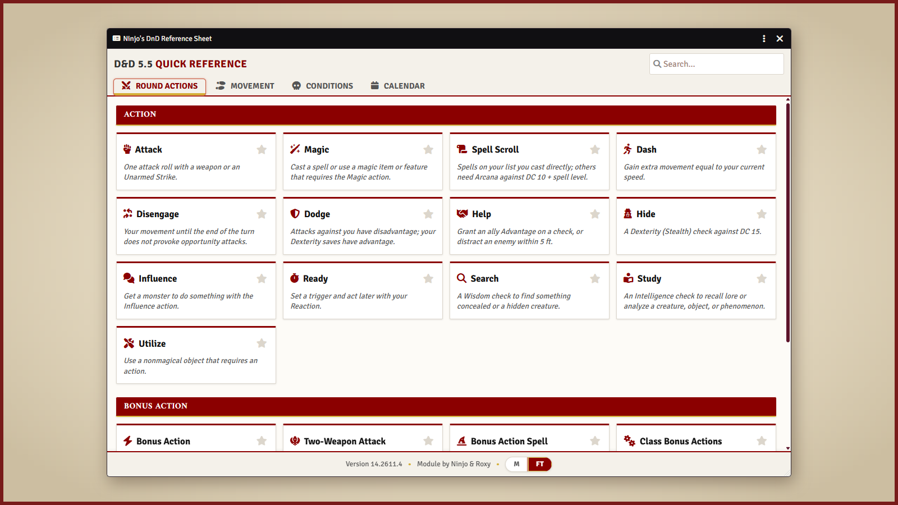
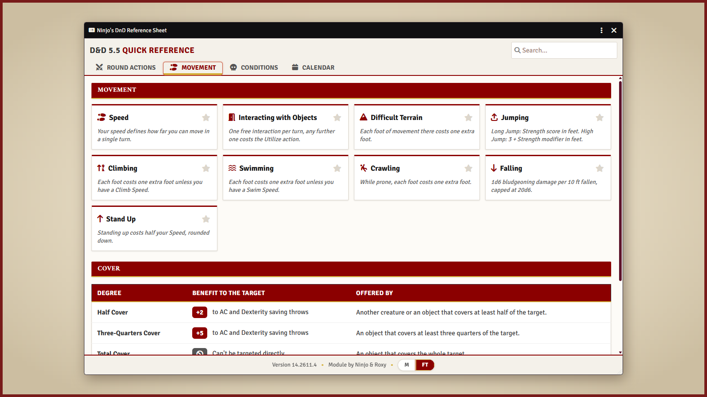
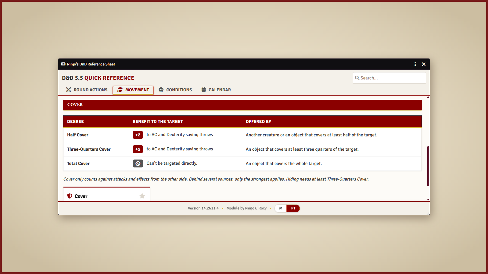
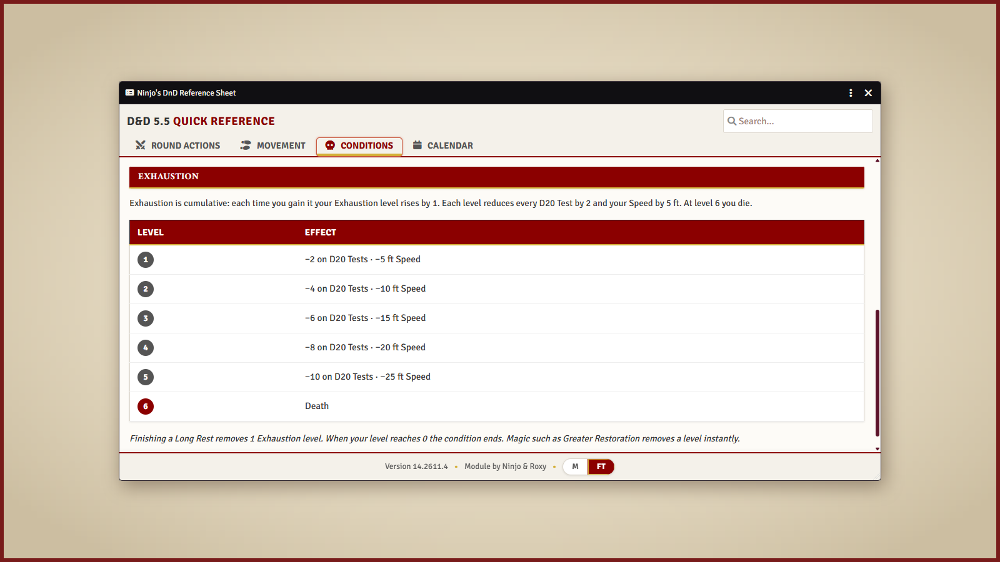
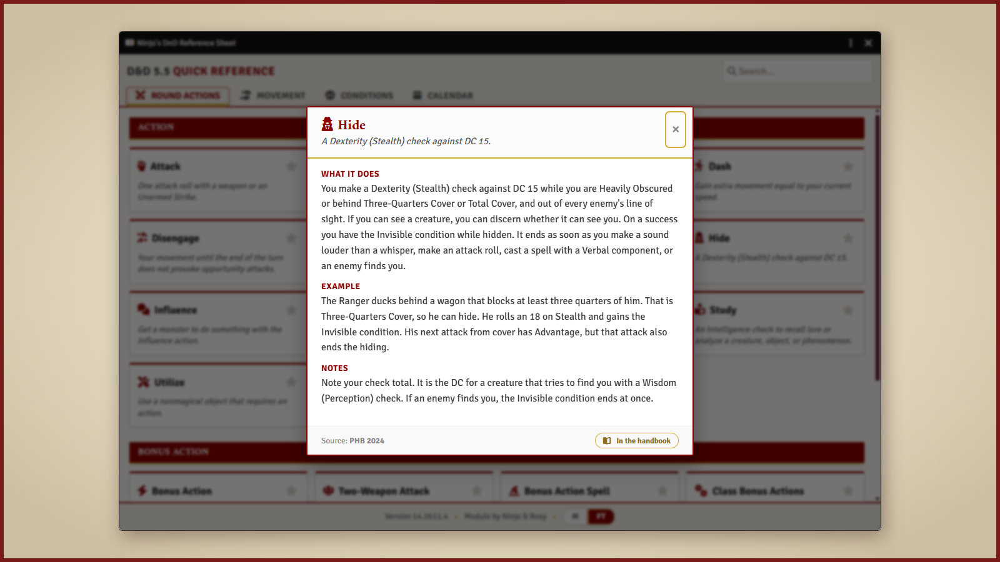
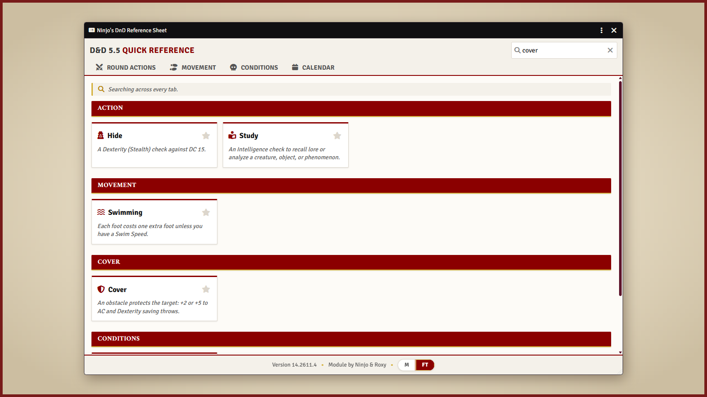
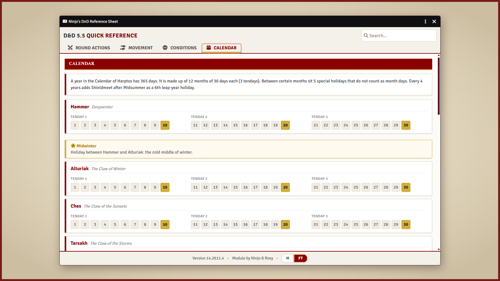

# Ninjo's DnD Reference Sheet (NDRS)

The rules your group looks up most, right inside Foundry: actions, movement, conditions,
exhaustion and the calendar, checked against the 2024 rules.

*(Scroll down for the German version / Weiter unten auf Deutsch)*

---

## 🇬🇧 English

"Wait, what does Frightened actually do again?" Questions like that come up every game night,
and usually right when things get exciting. Instead of flipping through the rulebook, you open the
DnD Reference Sheet right inside Foundry and have the answer in front of you within seconds.

The reference window gathers the rules a group reaches for most often: what you can do on your
turn, how movement works, what each condition does and what the levels of exhaustion mean. Every
entry has been checked against the 2024 Player's Handbook, and a bundled checker flags any wording
that slips in from the old edition. So whoever looks something up gets the rule that applies today,
not the one somebody remembers.



### What's inside

Under **Round Actions** you find every action, bonus action and reaction open to any character,
from Attack through Help and Hide to Ready, plus a card on spell scrolls. **Movement** covers climbing, swimming, jumping,
crawling, difficult terrain, your one free object interaction per turn and everything else that
matters when you move across the map. A table on **cover** shows the three degrees at a glance:
+2 for Half Cover, +5 for Three-Quarters Cover, and a target behind Total Cover can't be targeted
at all. Under
**Conditions** you find every condition with its exact effects, along with a table for the six
levels of exhaustion. And the **Calendar** shows the Calendar of Harptos with its twelve months,
the five holidays in between and Shieldmeet in leap years.







Every entry appears as a short card that tells you in one sentence what it is about. Click it and
the full explanation opens, with an example from play, the details people tend to miss, and the
book the rule comes from.



### Found in no time

The search runs across every section at once and also finds terms that only appear in an
explanation or an example. Cards you need all the time can be marked as favourites. They get a
gold border and move to the top of their section, separately for every user. Distances switch
between feet and metres at the bottom of the window, and every value changes along with it.



You open the window with `Shift + R` or with the button in the actor directory. From a journal
you can even open it straight on a particular section. Since the window only displays things and
never changes your world, you can safely give it to all your players. Then everyone looks things
up on their own, and you get asked a lot less.



### Installation

The DnD Reference Sheet is in the official Foundry package catalogue. In Foundry, open the
**Add-on Modules** tab, click **Install Module** and search for *NDRS*. Then enable it in your
world's module settings.

You can also use this manifest URL:
`https://github.com/Niclasp1501/Ninjos-DnD-Reference-Sheet--NDRS-/releases/latest/download/module.json`

You need Foundry VTT v13 or v14 and the `dnd5e` system from version 4.0. The module speaks English
and German.

### Together with other modules

The DnD Reference Sheet shares its design with **Ninjo's FANG** and the rest of the family. With
**Ninjo's In-Person Tools** running, it gets its own button in the tablet sheet view, and if you
use **Sheet Only**, you find the button in its bar. That way the rule is only a tap away on a
tablet too.

---

## 🇩🇪 Deutsch

„Wie war das noch mal mit Verängstigt?" Solche Fragen kommen an jedem Spielabend, und meistens
genau dann, wenn es gerade spannend wird. Statt im Regelbuch zu blättern, öffnest du das DnD
Reference Sheet direkt in Foundry und hast die Antwort in wenigen Sekunden vor dir.

Das Nachschlagefenster sammelt die Regeln, die in einer Runde am häufigsten gebraucht werden: was
man in seinem Zug alles tun kann, wie Bewegung funktioniert, was die einzelnen Zustände bewirken und
was die Stufen der Erschöpfung bedeuten. Jeder Eintrag ist gegen das Spielerhandbuch von 2024
geprüft, und ein mitgelieferter Prüfer schlägt an, sobald sich eine Formulierung aus der alten
Fassung einschleicht. Wer nachschlägt, bekommt also die Regel, die heute gilt, und nicht die, an die
sich jemand noch erinnert.


### Was drinsteht

Unter **Rundenaktionen** findest du alle Aktionen, Bonusaktionen und Reaktionen, die jedem Charakter
offenstehen, vom Angriff über Helfen und Verstecken bis zu Bereit halten, dazu eine Karte zu
Zauberschriftrollen. **Bewegung** erklärt
Klettern, Schwimmen, Springen, Kriechen, schwieriges Gelände, deine eine kostenlose Interaktion mit
einem Objekt pro Zug und alles Weitere, was beim Laufen über die Karte zählt. Eine Tabelle zur
**Deckung** zeigt die drei Grade auf einen Blick: +2 bei Teildeckung, +5 bei Dreivierteldeckung,
und hinter vollständiger Deckung kann ein Ziel gar nicht gewählt werden. Unter **Zustände** stehen alle Zustände mit ihren genauen Auswirkungen, dazu eine
Tabelle für die sechs Stufen der Erschöpfung. Der **Kalender** schließlich zeigt den Kalender von
Harptos mit seinen zwölf Monaten, den fünf Feiertagen dazwischen und dem Schildtreff im Schaltjahr.


Jeder Eintrag erscheint als kurze Karte, die in einem Satz sagt, worum es geht. Ein Klick darauf
öffnet die ausführliche Erklärung mit einem Beispiel aus dem Spiel, den Feinheiten, die gern
übersehen werden, und der Angabe, aus welchem Buch die Regel stammt.


### Schnell gefunden

Die Suche läuft über alle Bereiche zugleich und findet auch Begriffe, die nur in einer Erklärung
oder einem Beispiel vorkommen. Karten, die du ständig brauchst, markierst du als Favorit. Sie
bekommen einen goldenen Rahmen und rutschen an den Anfang ihres Abschnitts, und das für jeden
Benutzer getrennt. Entfernungen stellst du unten im Fenster zwischen Fuß und Meter um, und alle
Angaben ändern sich sofort mit.


Geöffnet wird das Fenster mit `Shift + R` oder über den Knopf im Akteursverzeichnis. Aus einem
Journal heraus lässt es sich sogar direkt auf einem bestimmten Bereich öffnen. Da das Fenster nur
anzeigt und nichts an deiner Welt verändert, kannst du es bedenkenlos allen Spielern freigeben.
Dann schlägt jeder selbst nach, und du wirst seltener gefragt.


### Installation

Das DnD Reference Sheet steht im offiziellen Foundry-Paketkatalog. Öffne in Foundry den Reiter
**Add-on-Module**, klicke auf **Modul installieren** und suche nach *NDRS*. Danach aktivierst du es
in den Moduleinstellungen deiner Welt.

Du kannst auch diese Manifest-Adresse verwenden:
`https://github.com/Niclasp1501/Ninjos-DnD-Reference-Sheet--NDRS-/releases/latest/download/module.json`

Du brauchst Foundry VTT v13 oder v14 und das System `dnd5e` ab Version 4.0. Das Modul
spricht Deutsch und Englisch.

### Zusammen mit anderen Modulen

Das DnD Reference Sheet trägt dasselbe Design wie **Ninjo's FANG** und die übrigen Module der
Familie. Laufen **Ninjo's In-Person Tools**, bekommt es einen eigenen Knopf in der Blattansicht der
Tablets, und wer **Sheet Only** benutzt, findet den Knopf dort in der Leiste. So ist die Regel auch
am Tablet nur einen Tipp entfernt.

---

## Support / Unterstützen

The modules are free and stay free. If they help your group, you can support my work on [Patreon](https://www.patreon.com/ninjosforge) and get premium add-ons in return. What you get there is on the [premium page of Ninjo's Forge](https://ninjos-forge.web.app/en/premium).

Die Module sind kostenlos und bleiben es. Wenn sie deiner Runde helfen, kannst du meine Arbeit auf [Patreon](https://www.patreon.com/ninjosforge) unterstützen und bekommst Premium-Erweiterungen dazu. Was es dort gibt, steht auf der [Premium-Seite der Forge](https://ninjos-forge.web.app/premium).

Thank you to the [Legends](https://ninjos-forge.web.app/en/legends) who support these modules on Patreon at the highest tier: **AaronShep**.

Danke an die [Legends](https://ninjos-forge.web.app/legends), die diese Module auf Patreon in der höchsten Stufe unterstützen: **AaronShep**.

---

## Technical notes

NDRS exposes a small API at `game.modules.get("ndrs").api` with `open()`, `close()`, `toggle()`,
`gotoTab(id)` and `setSearch(query)`. The tab ids are `round-actions`, `movement`, `conditions`
and `calendar`.

A journal can open NDRS on a specific tab with a plain link:

```html
<a class="ndrs-open-btn" data-ndrs-tab="conditions">Conditions</a>
```

`node tools/ndrs-validate.mjs` checks every entry for wording from the 2014 rules and for missing
translations. The conventions for contributors are in [AGENTS.md](AGENTS.md) and
[DEVELOPER_GUIDE.md](DEVELOPER_GUIDE.md).

---

## License / Lizenz

This base module is licensed under the **MIT License**.
**Note:** The license applies to the NDRS module itself. The summarized rule descriptions inside the module reference D&D 5.5 (2024) game mechanics, which are facts; their phrasing is original to this project.

Dieses Modul steht unter der **MIT-Lizenz**.
**Hinweis:** Die Lizenz gilt für das NDRS-Modul selbst. Die zusammengefassten Regelbeschreibungen beschreiben Spielmechaniken aus D&D 5.5 (2024); die Formulierungen sind eigene Zusammenfassungen für dieses Projekt.

---

## Credits

Module: **Ninjo & Roxy**.
Visual design language inherited from **FANG (Foundry Actor Nexus Graph)**.
Audit & validation tools: see `tools/ndrs-validate.mjs`.

For development conventions, see [DEVELOPER_GUIDE.md](DEVELOPER_GUIDE.md).
For workflow rules and the strict 2024 audit, see [AGENTS.md](AGENTS.md).
For the v1 content list, see [CONTENT-INVENTORY.md](CONTENT-INVENTORY.md).
For the roadmap, see [TODO.md](TODO.md).
